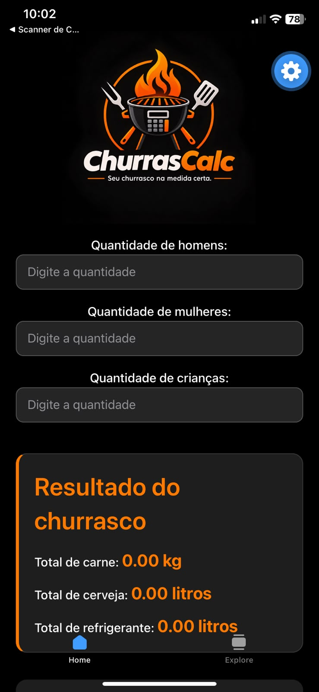
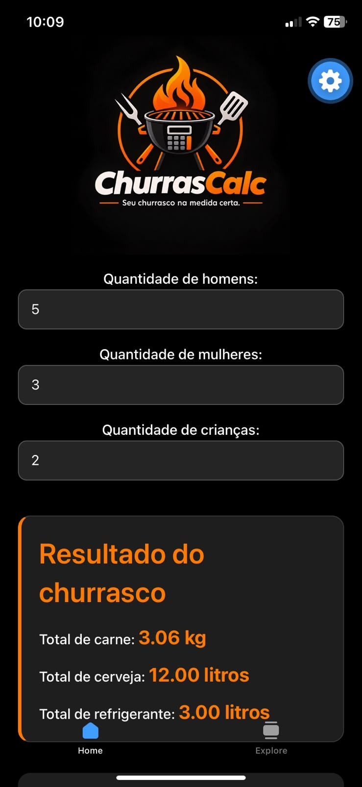

# Calculadora de Churrasco

Aplicativo mobile desenvolvido para facilitar o planejamento de churrascos, estimando quantidades de itens necessários de acordo com o número de participantes.

## Tecnologias utilizadas

- React Native
- Expo SDK 58
- TypeScript 6
- React 19
- Expo Router
- React Native Reanimated

## Funcionalidades

- Cálculo de carne conforme a quantidade de homens, mulheres e crianças
- Estimativa de consumo de cerveja e refrigerante
- Lista de compras personalizada
- Adição de produtos e quantidades
- Organização dos produtos por categorias
- Marcação dos itens já comprados
- Inclusão de carnes adicionais no cálculo total
- Estimativa da quantidade de carvão conforme o total de carne

## Telas do aplicativo

## Tela inicial

## Resultado do cálculo

## Objetivo

Projeto prático de desenvolvimento mobile, com foco em lógica de programação, construção de interfaces e utilização do React Native com Expo.

## Como executar

1. Clone este repositório.
2. Instale as dependências:

   `npm install`

3. Inicie o projeto:

   `npx expo start`

### Autor

Anderson Chaves da Cruz

[GitHub](https://github.com/Andcruz)
